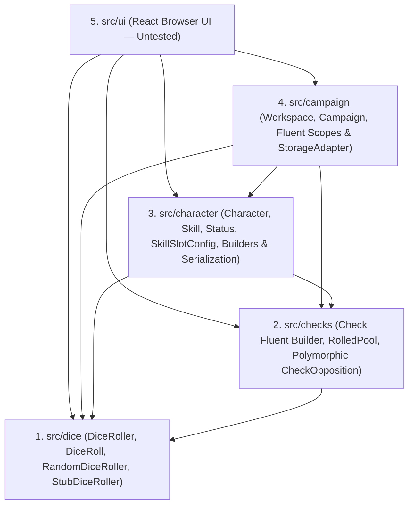

# Software Architecture

## 1. High-Level Overview

Roll for Shoes is a **100% client-side TypeScript web application** bundled with Vite, rendered with React, and verified at every non-UI module boundary with Vitest.

All game logic—dice rolling, check resolution, XP accounting, skill advancement, status modifiers, skill slots, serialization, and multi-campaign workspace management—lives in pure, framework-agnostic TypeScript classes and fluent builders (`src/dice`, `src/checks`, `src/character`, `src/campaign`). React lives strictly in `src/ui/` as a declarative view that **uses** domain methods and getters without re-implementing any game rules.

---

## 2. Module Dependency Graph

Dependencies flow strictly **top-to-bottom** (no cycles, no upward imports, no reaching into another module's internal files—all cross-module imports go through `src/<module>/index.ts`):



### Module Responsibilities & Boundaries

| Module | Path | Allowed Internal Imports | Responsibility | Tested? |
| :--- | :--- | :--- | :--- | :--- |
| **1. Dice** | `src/dice/` | *(none)* | Defines `DieValue` (`1..6`), `DiceRoll` (computed `total`), and `DiceRoller` (`roll(count)`). Provides `RandomDiceRoller` (cryptographic RNG with injectable byte source) and `StubDiceRoller` (deterministic FIFO queue). | **Yes** (`dice.test.ts`) |
| **2. Checks** | `src/checks/` | `src/dice` | Fluent `Check` builder, `RolledPool` with computed getters, and polymorphic `CheckOpposition` implementations (`StaticOpposition`, `RolledOpposition`, `DifficultyOpposition`). | **Yes** (`checks.test.ts`) |
| **3. Character** | `src/character/` | `src/dice`, `src/checks` | Immutable `Character` entity with fluent builders (`makeCheck`, `advance`, `Character.builder`), `Skill`, `Status` (`Status.create` / `Status.roll`), `SkillSlotConfig`, optional `portrait`, and versioned JSON serialization. | **Yes** (`character.test.ts`) |
| **4. Campaign & Storage** | `src/campaign/` | `src/dice`, `src/checks`, `src/character` | Immutable `Workspace` and `Campaign` entities with scoped fluent traversal (`workspace.activeCampaign.character('foo').makeCheck(...)`), roll history, campaign JSON import/export, and `StorageAdapter` (`LocalStorageAdapter` + `MemoryStorageAdapter`). | **Yes** (`campaign.test.ts`) |
| **5. Browser UI** | `src/ui/` | `src/dice`, `src/checks`, `src/character`, `src/campaign` | Responsive React components rendering a hideable default-closed campaign sidebar (with `Advanced Options` export/import menu), `Campaign Options` menu (`RenameCampaignDialog` + `CampaignSettingsDialog`), wider simultaneous multi-character cards with `64×64` portraits, check builder, post-roll advancement flow, statuses, and skill slots. Wires `RandomDiceRoller` and persistent `LocalStorageAdapter` at application boot. | **No** *(verified via `tsc` & `vite build`)* |

---

## 3. Repository Directory Layout

```text
roll_for_shoes/
├── AGENTS.md                        # Workspace-wide rules enforced for all agents/subagents
├── .agents/
│   └── plugins/
│       └── rfs-team/                # Workspace-scoped subagent definitions
│           ├── plugin.json
│           └── agents/
│               ├── rfs-coordinator.md
│               ├── rfs-test-author.md
│               ├── rfs-implementer.md
│               ├── rfs-ui-builder.md
│               └── rfs-commit-reviewer.md
├── docs/
│   ├── README.md
│   ├── architecture.md
│   ├── interfaces.md
│   ├── test-cases.md
│   ├── implementation-plan.md
│   └── subagents.md
├── reference/
│   └── rules.md                     # Canonical Roll for Shoes TTRPG rules
├── public/
│   ├── manifest.webmanifest         # PWA manifest (explicit id "/", standalone, separated any/maskable icons)
│   └── icons/                       # SVG + 192/512 PNG + 512 maskable PNG app icons
├── index.html                       # Vite HTML entrypoint (viewport-fit=cover, dual theme-color, manifest)
├── package.json
├── tsconfig.json
├── vite.config.ts                   # Vite + Vitest config + inline pwaServiceWorkerPlugin emitting sw.js
└── src/
    ├── main.tsx                     # Mounts <App /> and registers /sw.js in production builds
    ├── dice/
    │   ├── index.ts
    │   ├── types.ts
    │   ├── dice-roll.ts
    │   ├── random-dice-roller.ts
    │   ├── stub-dice-roller.ts
    │   └── dice.test.ts
    ├── checks/
    │   ├── index.ts
    │   ├── types.ts
    │   ├── rolled-pool.ts
    │   ├── opposition.ts
    │   ├── check.ts
    │   └── checks.test.ts
    ├── character/
    │   ├── index.ts
    │   ├── skill.ts
    │   ├── status.ts
    │   ├── skill-slots.ts
    │   ├── character.ts
    │   ├── builders.ts
    │   ├── serialize.ts
    │   └── character.test.ts
    ├── campaign/
    │   ├── index.ts
    │   ├── campaign.ts
    │   ├── workspace.ts
    │   ├── scopes.ts
    │   ├── storage.ts
    │   └── campaign.test.ts
    └── ui/
        ├── App.tsx
        ├── portrait-image.ts
        ├── styles.css
        └── components/
            ├── ActionMenu.tsx
            ├── AppIcon.tsx
            ├── CampaignSidebar.tsx
            ├── CampaignSettingsDialog.tsx
            ├── RenameCampaignDialog.tsx
            ├── CharacterGrid.tsx
            ├── CharacterCard.tsx
            ├── CreateCharacterDialog.tsx
            ├── CheckRollerPanel.tsx
            ├── AdvancementPrompt.tsx
            ├── StatusManager.tsx
            ├── SkillSlotBar.tsx
            ├── RollHistoryLog.tsx
            └── InstallAppButton.tsx
```

---

## 4. Key Design Decisions (SOLID & Clean Domain Model)

### 4.1 Immutable Entities + Fluent Builders
Domain objects (`Character`, `Campaign`, `Workspace`) are **immutable classes**:
- Every state-modifying method or terminal builder call returns a **new** instance (`next !== prev`) without mutating `this`, making React `useState` updates safe and bug-free by reference inequality.
- Fluent builders (`Check.withDice(2).against(...)`, `character.makeCheck('Climbing').against(...)`, `workspace.activeCampaign.character('Bob').makeCheck('Climbing').against(...)`) keep multi-option operations readable and extensible without combinatorial helper functions or wide option-bag signatures.

### 4.2 Polymorphic `CheckOpposition` (Open/Closed Principle)
Rather than coupling `Check` to a tagged-union `switch` over static targets, opposed pools, and difficulty presets, `CheckOpposition` is a single behavioral interface (`resolve(diceRoller): OppositionResult`) with three focused implementations:
- `StaticOpposition(target)` — returns `{ total: target }` without rolling dice.
- `RolledOpposition(diceCount, options)` — rolls `diceCount` d6s and returns `{ total: pool.finalTotal, pool }`.
- `DifficultyOpposition(tier, mode, options)` — uses integer `DifficultyTier` (`Easy = 1 .. VeryHard = 4`) to delegate to `tier * 3` (static) or `tier`d6 (dynamic).

### 4.3 Computed Getters Over Stored Totals (DRY / Single Source of Truth)
Derived values are never persisted or stored as redundant fields alongside source arrays:
- `DiceRoll.total` sums `dice`.
- `RolledPool` computes `rawTotal`, `modifierTotal`, `finalTotal`, `nonSixCount`, and `naturalAllSixes` from `rawDice` and `modifiers`.
- `CheckResult` computes `margin` and `outcome` from `actor`, `opposition`, and `tiesMode`.
- `PendingAdvancement` computes `targetLevel`, `xpCostToAdvance`, and `naturalAllSixes` from `usedSkillLevel` and `rawDice`.
- `AdvancementOutcome.totalXpSpent`, `CharacterCheckOutcome.xpEarned`, and `SkillSlotSummary.availableSlots` / `nextSlotXpCost` are likewise computed getters.

### 4.4 Pending Advancement Lifecycle
- When a character resolves a check, `+1 XP` is added first if `outcome === 'failure'`.
- `pendingAdvancement` is attached to the returned `Character` **if and only if** the character can actually advance on that roll (`xpCostToAdvance === 0` for natural all-`6`s, or `updatedXp >= xpCostToAdvance`). Otherwise `pendingAdvancement` is `null`.
- Starting a new check clears any prior unclaimed `pendingAdvancement` first (setting a new one only if the new roll is eligible). Calling `character.dismissAdvancement()` clears it explicitly without altering XP or skills.
- `pendingAdvancement` serializes with `Character`, surviving browser reloads.

### 4.5 Independent Skill Slots vs. Slot Purchasing
- When `campaign.rules.skillSlots` is `null`, skill counts per level are unrestricted.
- When a `SkillSlotConfig` is configured, `limitsByLevel` caps apply (`SkillSlotConfig.triangle()` caps Level 2 at `4`, Level 3 at `3`, Level 4 at `2`).
- `allowSlotPurchase: boolean` is non-optional and defaults to `false`:
  - When `false`, players cannot purchase slots, any `purchasedSlots` on a character are ignored, and levels above the highest configured triangle level default to `1` slot so progression is never dead-ended.
  - When `true`, players may spend `2 * level` XP via `character.purchaseSkillSlot(level, config)` or simultaneously via `.purchasingSlot()` during advancement, and levels above the configured triangle default to `0` base slots until purchased.

### 4.6 Progressive Web App (PWA), Portraits & Responsive Layout
- **Web App Manifest & Icons**: `public/manifest.webmanifest` declares `"id": "roll_for_shoes"`, `"display": "standalone"`, and separate `"purpose": "any"` (`icon.svg`, `icon-192.png`, `icon-512.png`) and `"purpose": "maskable"` (`icon-maskable-512.png`) shoe-with-6-sided-die icon entries, paired with `viewport-fit=cover` and dual light/dark `theme-color` metadata in `index.html`.
- **Offline Precache Service Worker**: `pwaServiceWorkerPlugin` in `vite.config.ts` emits `dist/sw.js` at build time using a deterministic 32-bit FNV-1a bundle hash (`rfs-pwa-<hash>`), precaching relative `./` shell assets, manifest, icons, and hashed Vite chunks for root or subpath hosting. Navigation requests use network-first with cached `./index.html` fallback; same-origin static assets use cache-first; stale `rfs-pwa-*` caches are purged on `activate`. `src/main.tsx` registers `./sw.js` on `window` `load` in production builds.
- **In-App Install Control & Standalone Layout**: `InstallAppButton` (`src/ui/components/InstallAppButton.tsx`) stays hidden in `display-mode: standalone` or when neither `navigator.install()` nor `beforeinstallprompt` is available, preserves keyboard focus via `aria-disabled="true"` while awaiting installation, clears single-use deferred prompts before calling `.prompt()`, allows retries after `AbortError`, and announces status via `role="status"`. `src/ui/styles.css` applies `env(safe-area-inset-*)` padding for edge-to-edge standalone display.
- **Character Portraits, Menus & Hideable Sidebar**: `Character` stores an optional non-blank `portrait?: string` persisted in `Character`, `Campaign`, and `Workspace` JSON. `src/ui/portrait-image.ts` center-crops uploaded images to `<= 256×256` WebP (with JPEG fallback) so portraits fit cleanly in `localStorage` and exported JSON backups. Once a campaign is displayed, `CampaignSidebar` defaults to hidden across both wide (`>= 960px`, toggling a `300px` column) and narrow (`< 960px`, toggling a stacked drawer) viewports; `ActionMenu` groups `Export`/`Import` under `Advanced Options` in the sidebar and `Rename Campaign` + `Campaign Rules` under `Campaign Options` on the campaign header.

---

## 5. Testing & Quality Mandate

1. **Test Every Public Function, Method & Getter at Each Non-UI Boundary**:
   - `src/dice/dice.test.ts` -> `src/dice/index.ts`
   - `src/checks/checks.test.ts` -> `src/checks/index.ts` + real `src/dice`
   - `src/character/character.test.ts` -> `src/character/index.ts` + real `src/checks` + real `src/dice`
   - `src/campaign/campaign.test.ts` -> `src/campaign/index.ts` + real `src/character` + real `src/checks` + real `src/dice` + real `MemoryStorageAdapter` & `LocalStorageAdapter`
2. **Minimal Implementation for High Coverage**: `rfs-implementer` writes only the code necessary to pass tests cleanly, verified via Vitest coverage (`@vitest/coverage-v8`).
3. **Only Dice May Be Stubbed**: Only `StubDiceRoller` (plus `RandomDiceRoller`'s optional byte-source callback inside `dice.test.ts`) is ever faked. Zero `vi.mock`, `vi.fn`, or `vi.spyOn` on `checks`, `character`, `campaign`, or `StorageAdapter`.
4. **Deterministic Roll Order**: Actor dice are always rolled first; `opposition.resolve(diceRoller)` always runs second.
5. **UI Verification**: `src/ui/` is verified via `npm run typecheck`, `npm run build`, and existing domain `npm test` suites.
