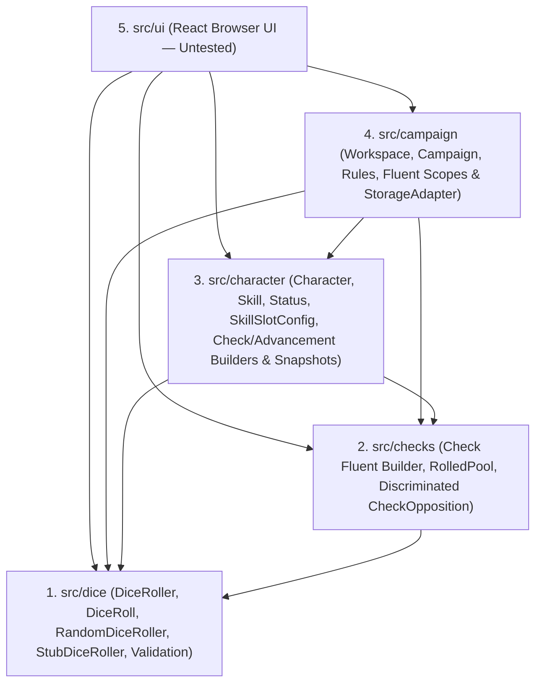

# Software Architecture

## 1. High-Level Overview

Roll for Shoes is a **100% client-side TypeScript web application** bundled with Vite, rendered with React, and verified at every non-UI module boundary with Vitest (`16` test suites, `325` focused boundary tests, `100%` statement/branch/function/line coverage).

All game logic—dice rolling, check resolution, XP accounting, skill advancement, status modifiers, skill slots, serialization, and multi-campaign workspace management—lives in pure, framework-agnostic TypeScript classes and fluent builders (`src/dice`, `src/checks`, `src/character`, `src/campaign`). React lives strictly in `src/ui/` as a declarative view that **uses** domain methods and getters without re-implementing any game rules.

---

## 2. Module Dependency Graph

Dependencies flow strictly **top-to-bottom** (no cycles, no upward imports, no reaching into another module's internal files—all cross-module imports go through `src/<module>/index.ts`):



### Module Responsibilities & Boundaries

| Module | Path | Allowed Internal Imports | Responsibility | Tested? |
| :--- | :--- | :--- | :--- | :--- |
| **1. Dice** | `src/dice/` | *(none)* | Defines `DieValue` (`1..6`), `isDieValue`, `assertPositiveInt`, `validateDiceValues`, `DiceRoll` (computed `total`), and `DiceRoller` (`roll(count)`). Provides `RandomDiceRoller` and `StubDiceRoller`. | **Yes** (`dice-roll.test.ts`, `random-dice-roller.test.ts`) |
| **2. Checks** | `src/checks/` | `src/dice` | Fluent `Check` -> terminal `ReadyCheck<TOpp>` -> `CheckResult<TOpp>`, `RolledPool` computed getters, discriminated `OppositionResult`, and polymorphic `CheckOpposition` (`StaticOpposition`, `RolledOpposition.withDice`/`fromDice`, `DifficultyOpposition.static`/`dynamic`). | **Yes** (`rolled-pool.test.ts`, `opposition.test.ts`, `check.test.ts`, `check-modifiers.test.ts`) |
| **3. Character** | `src/character/` | `src/dice`, `src/checks` | Immutable `Character` (`Character.create`), `Skill`, `Status` (`Status.create` / `Status.roll`), `SkillSlotConfig` + discriminated `SkillSlotSummary`, `check-builders.ts`, `advancement.ts` (`ClaimableAdvancement`), `portrait`, and typed `CharacterSnapshot` / JSON serialization. | **Yes** (`character-{creation,statuses,checks,advancement,slots,serialization}.test.ts`) |
| **4. Campaign & Storage** | `src/campaign/` | `src/dice`, `src/checks`, `src/character` | Immutable `Workspace` & `Campaign` (strict IDs + `findCharacterByName`), centralized `rules.ts`, compositional fluent scopes (`ScopedDefenderBuilder`, `ScopedClaimableAdvancement`), discriminated `CampaignRollLogEntry`, symmetric `serialize`/`deserialize`, and `StorageAdapter`. | **Yes** (`campaign-{entity,scopes,persistence}.test.ts`, `workspace.test.ts`) |
| **5. Browser UI** | `src/ui/` | `src/dice`, `src/checks`, `src/character`, `src/campaign` | Responsive React components with narrow props, shared primitives (`ModalDialog`, `CharacterAvatar`, `DiceRow`, `RollSummary`, `ActionMenu`, `formatError`), discriminated `OppositionFormState` & `activeDialog`, nullable-array `PhysicalDiceInput`, `<= 256×256` portraits, and PWA install controls. | **No** *(verified via `tsc` & `vite build`)* |

---

## 3. Repository Directory Layout

```text
roll_for_shoes/
├── README.md                        # Quick start & index of per-module guides
├── AGENTS.md                        # Workspace-wide rules enforced for all agents/subagents
├── .agents/
│   └── plugins/
│       └── rfs-team/                # Workspace-scoped subagent definitions
│           ├── plugin.json
│           └── agents/
│               ├── rfs-coordinator.md
│               ├── rfs-test-author.md
│               ├── rfs-implementer.md
│               ├── rfs-ui-builder.md
│               └── rfs-commit-reviewer.md
├── docs/
│   ├── README.md
│   ├── architecture.md
│   ├── interfaces.md
│   ├── test-cases.md
│   ├── implementation-plan.md
│   └── subagents.md
├── reference/
│   └── rules.md                     # Canonical Roll for Shoes TTRPG rules
├── public/
│   ├── manifest.webmanifest         # PWA manifest ("id": "roll_for_shoes", standalone, any/maskable icons)
│   └── icons/                       # SVG + 192/512 PNG + 512 maskable PNG app icons
├── index.html                       # Vite HTML entrypoint (viewport-fit=cover, dual theme-color, manifest)
├── package.json
├── tsconfig.json
├── vite.config.ts                   # Vite + Vitest config + inline pwaServiceWorkerPlugin emitting sw.js
└── src/
    ├── main.tsx                     # Mounts <App /> and registers ./sw.js in production builds
    ├── dice/
    │   ├── README.md
    │   ├── index.ts
    │   ├── types.ts
    │   ├── dice-roll.ts
    │   ├── random-dice-roller.ts
    │   ├── stub-dice-roller.ts
    │   ├── dice-roll.test.ts
    │   └── random-dice-roller.test.ts
    ├── checks/
    │   ├── README.md
    │   ├── index.ts
    │   ├── types.ts
    │   ├── rolled-pool.ts
    │   ├── opposition.ts
    │   ├── check.ts
    │   ├── rolled-pool.test.ts
    │   ├── opposition.test.ts
    │   ├── check.test.ts
    │   └── check-modifiers.test.ts
    ├── character/
    │   ├── README.md
    │   ├── index.ts
    │   ├── skill.ts
    │   ├── status.ts
    │   ├── skill-slots.ts
    │   ├── check-builders.ts
    │   ├── advancement.ts
    │   ├── character.ts
    │   ├── serialize.ts
    │   ├── character-creation.test.ts
    │   ├── character-statuses.test.ts
    │   ├── character-checks.test.ts
    │   ├── character-advancement.test.ts
    │   ├── character-slots.test.ts
    │   └── character-serialization.test.ts
    ├── campaign/
    │   ├── README.md
    │   ├── index.ts
    │   ├── rules.ts
    │   ├── campaign.ts
    │   ├── workspace.ts
    │   ├── scopes.ts
    │   ├── serialize.ts
    │   ├── storage.ts
    │   ├── campaign-entity.test.ts
    │   ├── workspace.test.ts
    │   ├── campaign-scopes.test.ts
    │   └── campaign-persistence.test.ts
    └── ui/
        ├── README.md
        ├── App.tsx
        ├── error.ts
        ├── portrait-image.ts
        ├── styles.css
        └── components/
            ├── ActionMenu.tsx
            ├── AdvancementPrompt.tsx
            ├── AppIcon.tsx
            ├── CampaignSettingsDialog.tsx
            ├── CampaignSidebar.tsx
            ├── CharacterAvatar.tsx
            ├── CharacterCard.tsx
            ├── CharacterGrid.tsx
            ├── CheckRollerPanel.tsx
            ├── CreateCharacterDialog.tsx
            ├── DiceRow.tsx
            ├── InstallAppButton.tsx
            ├── ModalDialog.tsx
            ├── PhysicalDiceInput.tsx
            ├── RenameCampaignDialog.tsx
            ├── RollHistoryLog.tsx
            ├── RollSummary.tsx
            ├── SkillSlotBar.tsx
            └── StatusManager.tsx
```

---

## 4. Key Design Decisions (SOLID, Type Safety & Clean Domain Model)

### 4.1 Immutable Entities, Single Canonical Factories & Terminal Builders
- Every domain entity (`Character`, `Campaign`, `Workspace`) is frozen and immutable (`next !== prev`).
- Operations have **one canonical way** to express them: `Character.create(name, options?)` (handling optional ID, portrait, and starting skills in one factory), `RolledOpposition.withDice`/`fromDice` (matching `Check.withDice`/`fromDice`), symmetric `serialize()` / `deserialize()` on both `Character` and `Campaign` / `Workspace`, and strict entity IDs on destructive/targeted lookups (`removeStatus(statusId)`, `removeCharacter(characterId)`, `selectCampaign(campaignId)`, `deleteCampaign(campaignId)`, `campaign(campaignId)`).
- Terminal builder stages (`ReadyCheck`, `ReadyCharacterCheck`, `ReadyOpposedCharacterCheck`, `ClaimableAdvancement`, `ScopedClaimableAdvancement`) expose only their terminal action (`resolve` / `roll` / `claim`), eliminating duplicate post-transition setter methods and preventing conflicting advancement slot strategies at compile time.

### 4.2 Polymorphic `CheckOpposition<TResult>` & Discriminated State Unions
- `OppositionResult` (`StaticOppositionResult | RolledOppositionResult`) and `DifficultyOpposition.static` / `DifficultyOpposition.dynamic` (`StaticDifficultyOpposition | DynamicDifficultyOpposition`) encode pool presence and physical-dice eligibility directly in the type system.
- `SkillSlotSummary` (`UnrestrictedSkillSlotSummary | CappedSkillSlotSummary`) and `CampaignRollLogEntry` (`VsOppositionRollLogEntry | CharacterOpposedRollLogEntry`) eliminate nullable/optional field combinations that required defensive fallbacks.
- In `src/ui`, `CheckRollerPanel` uses `OppositionFormState` (with separate actor vs. defender status selections), `PhysicalDiceInput` uses `readonly DieValue[] | null`, and `App` uses `activeDialog: 'none' | 'rename' | 'rules'`.

### 4.3 Computed Getters Over Stored Totals (DRY / Single Source of Truth)
Derived values are never persisted or stored as redundant fields alongside source arrays:
- `DiceRoll.total` sums `dice`.
- `RolledPool` computes `rawTotal`, `modifierTotal`, `finalTotal`, `nonSixCount`, and `naturalAllSixes` from `rawDice` and `modifiers`.
- `CheckResult` computes `margin` and `outcome` from `actor`, `opposition`, and `tiesMode`.
- `PendingAdvancement` delegates `xpCostToAdvance` and `naturalAllSixes` to `RolledPool` and computes `targetLevel`.
- `AdvancementOutcome.totalXpSpent`, `CharacterCheckOutcome.xpEarned`, `OpposedCharacterCheckOutcome.actorXpEarned` / `defenderXpEarned`, and `CappedSkillSlotSummary.availableSlots` are computed getters, while `SkillSlotConfig.slotCostForLevel(level)` centralizes `2 * level`.

### 4.4 Encapsulated Snapshot Mappers & Clean Scope Composition
- `Character`, `Campaign`, and `Workspace` keep private constructors and bind module-internal factories via `static {}` initialization blocks—never leaking `@internal static rehydrate` methods onto public classes.
- `src/character` exports typed `toCharacterSnapshot` and `fromCharacterSnapshot` so `src/campaign/serialize.ts` maps embedded characters directly without double JSON stringification/parsing.
- `ScopedDefenderBuilder` wraps `OpposedParticipantBuilder` via object composition rather than `Object.create` prototype delegation.

### 4.5 Progressive Web App (PWA), Portraits & Responsive Layout
- **Manifest, Icons & Service Worker**: `public/manifest.webmanifest`, `public/icons/*`, and `pwaServiceWorkerPlugin` in `vite.config.ts` provide offline-capable standalone installation with subpath-safe `./` precaching.
- **Portraits, `<ModalDialog>` & Narrow Leaf Props**: `src/ui/portrait-image.ts` downscales uploaded portraits to `<= 256×256` WebP/JPEG; `<ModalDialog>` centralizes native `<dialog>` accessibility and backdrop light-dismiss; leaf components accept narrow domain props rather than coupling to `Workspace`.

---

## 5. Testing & Quality Mandate

1. **Focused, Single-Behavior Boundary Tests Across 16 Suites**:
   - `src/dice/{dice-roll,random-dice-roller}.test.ts` -> `src/dice/index.ts`
   - `src/checks/{rolled-pool,opposition,check,check-modifiers}.test.ts` -> `src/checks/index.ts` + real `src/dice`
   - `src/character/character-{creation,statuses,checks,advancement,slots,serialization}.test.ts` -> `src/character/index.ts` + real `src/checks` + real `src/dice`
   - `src/campaign/{campaign-entity,workspace,campaign-scopes,campaign-persistence}.test.ts` -> `src/campaign/index.ts` + real `src/character` + real `src/checks` + real `src/dice` + real `MemoryStorageAdapter` & `LocalStorageAdapter`
2. **100% Coverage & Zero Mocks**: Maintained at 100% statements, branches, functions, and lines via `@vitest/coverage-v8`. Only `StubDiceRoller` (plus `RandomDiceRoller`'s optional byte-source callback inside `random-dice-roller.test.ts`) is ever faked.
3. **Deterministic Roll Order**: Actor dice are always resolved first and `opposition.resolve(diceRoller)` always runs second.
4. **UI Verification**: `src/ui/` is verified via `npm run typecheck`, `npm run build`, and the domain `npm test` suites.
