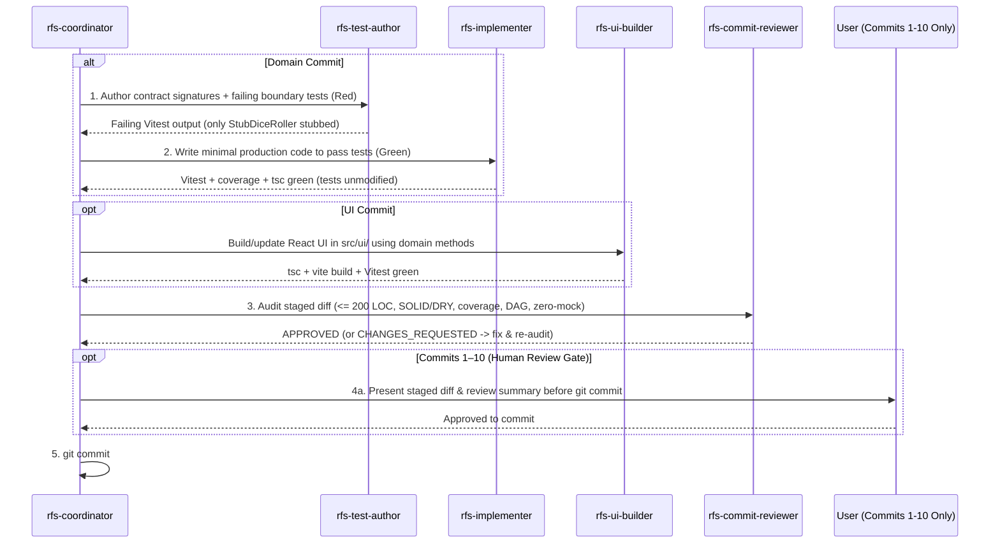

# Implementation Plan

## Execution Model & Size / Review Policies

1. **Commit Size Budget**:
   - **Target**: **~100 lines of code** per commit.
   - **Hard Limit**: **<= 200 lines of code** per commit (measured across added/modified lines in `src/` production + test files and project configs, excluding `package-lock.json` and markdown documentation). Any diff exceeding 200 LOC is automatically rejected by `rfs-commit-reviewer` and must be split.
2. **Human Review Gate (Commits 1–6 — Completed)**:
   - Commits 1 through 6 paused for user review prior to `git commit`.
3. **Autonomous Execution (Commits 7–36)**:
   - Starting at **Commit 7**, `rfs-coordinator` runs Red -> Green -> UI (where applicable) -> `rfs-commit-reviewer` audit -> `git commit` autonomously through **Commit 36**.

### Per-Commit Workflow

---

## Commit Roadmap

### Phase 0: Documentation & Agent Setup

| Commit | Summary | Files | Gate |
| :--- | :--- | :--- | :--- |
| **Commit 0** | Documentation, module contracts, test cases, commit plan, `AGENTS.md`, `.gitignore`, and `.agents/plugins/rfs-team/` subagents | `docs/*`, `AGENTS.md`, `.gitignore`, `.agents/**` | Docs baseline |

---

### Milestone 1: Core Domain — Basic Rules (Commits 1–14)

> [!IMPORTANT]
> **Commits 1–10 require explicit user review before `git commit`.**

| Commit | Est. LOC | Scope & Capabilities | Test Cases | Review Mode |
| :--- | :---: | :--- | :--- | :--- |
| **Commit 1** | ~115 | Project tooling (`package.json` with Vitest + `@vitest/coverage-v8`, `tsconfig.json`, `vite.config.ts`) + `DieValue`, `isDieValue`, `DiceRoll` (`get total()`), and `DiceRoller` interface in `src/dice/` | `DICE-01`..`03` | **User Review (1/10)** |
| **Commit 2** | ~110 | `StubDiceRoller` (`enqueue`, `get remaining()`, FIFO `roll(count)`, face & count validation, exhaustion error) in `src/dice/` | `DICE-04`..`08` | **User Review (2/10)** |
| **Commit 3** | ~105 | `RandomDiceRoller` (optional `RandomBytesSource` injection, `< 252` rejection sampling, `count` validation) in `src/dice/` | `DICE-09`..`11` | **User Review (3/10)** |
| **Commit 4** | ~135 | `RolledPool` (computed getters), `CheckOpposition` & `OppositionResult` (`total`), `StaticOpposition`, `CheckResult` (`margin`, `outcome`), and fluent `Check.withDice(n).against(opp).resolve(roller)` in `src/checks/` | `CHK-BASIC-01`..`09` | **User Review (4/10)** |
| **Commit 5** | ~130 | `RolledOpposition` (actor-first, opponent-second roll order) + symmetric opponent pool & invalid `diceCount` boundary tests in `src/checks/` | `CHK-BASIC-10`..`18` | **User Review (5/10)** |
| **Commit 6** | ~135 | `Skill` (`level >= 1` integer check) & immutable `Character` (`create`, `builder().withId()`, `skill()`, `addSkill()`) in `src/character/` | `CHR-BASIC-01`..`06` | **User Review (6/10)** |
| **Commit 7** | ~145 | `PendingAdvancement` (computed getters), fluent `character.makeCheck(skill).withAction(...).against(opp).roll(roller)`, `CharacterCheckOutcome`, eligibility-only advancement lifecycle, and `dismissAdvancement()` in `src/character/` | `CHR-BASIC-07`..`13` | **User Review (7/10)** |
| **Commit 8** | ~135 | Fluent `character.advance(newSkillName).claim()` & `AdvancementOutcome` (natural all-`6`s `0 XP` & `1 XP` per non-`6` die, immediate post-failure spend, double-claim protection) in `src/character/` | `CHR-BASIC-14`..`19` | **User Review (8/10)** |
| **Commit 9** | ~135 | Character-vs-character opposed checks (`makeCheck(skill).againstCharacter(defender, defenderSkill).roll(roller)`) & `OpposedCharacterCheckOutcome` in `src/character/` | `CHR-BASIC-20`..`23` | **User Review (9/10)** |
| **Commit 10** | ~135 | `character.serialize()` & `Character.deserialize()` (`schemaVersion: 1` validation, restoring class instances & `pendingAdvancement`) in `src/character/` | `CHR-BASIC-24`..`26` | **User Review (10/10)** |
| **Commit 11** | ~135 | Immutable `Campaign` entity (`create`, `rename`, `withDescription`, `withRules`, `addCharacter`, `removeCharacter`, `replaceCharacter`, `findCharacter`) in `src/campaign/` | `CMP-BASIC-01`..`02` | Autonomous |
| **Commit 12** | ~150 | `Campaign.character(idOrName)` fluent scopes (`makeCheck`, `againstCharacter`, `advance`, `dismissAdvancement`, `update`) & `rollLog` recording in `src/campaign/` | `CMP-BASIC-03`..`05` | Autonomous |
| **Commit 13** | ~150 | Immutable `Workspace` (`empty`, `createCampaign`, `selectCampaign`, `deleteCampaign`, `tryGetActiveCampaign`, `activeCampaign`, `campaign()`) & `WorkspaceCampaignScope` in `src/campaign/` | `CMP-BASIC-06`..`07` | Autonomous |
| **Commit 14** | ~155 | `StorageAdapter`, `MemoryStorageAdapter`, `LocalStorageAdapter`, `Workspace` `serialize`/`deserialize`/`save`/`load`, and `Campaign` `exportJson`/`fromJson`/`importCampaign` in `src/campaign/` | `CMP-BASIC-08`..`10` | Autonomous |

---

### Milestone 2: Browser UI — Basic Rules MVP (Commits 15–19)

| Commit | Est. LOC | Scope & Capabilities | Verification | Review Mode |
| :--- | :---: | :--- | :--- | :--- |
| **Commit 15** | ~135 | `index.html`, `src/main.tsx`, base CSS layout/tokens, and `<App />` shell wiring `Workspace.load`, auto-save, and `LocalStorageAdapter` / `MemoryStorageAdapter` switching | `tsc`, `vite build`, `vitest` | Autonomous |
| **Commit 16** | ~145 | `<CampaignSidebar />` (create, switch, rename, delete campaigns; JSON export/import; storage mode toggle) | `tsc`, `vite build` (`UI-01`, `UI-02`) | Autonomous |
| **Commit 17** | ~150 | `<CharacterGrid />`, `<CharacterCard />`, and `<CreateCharacterDialog />` rendering multiple characters simultaneously side-by-side | `tsc`, `vite build` (`UI-01`) | Autonomous |
| **Commit 18** | ~155 | `<CheckRollerPanel />` (actor + skill vs. `StaticOpposition`, `RolledOpposition`, or another `Character` in the campaign) | `tsc`, `vite build` (`UI-04`) | Autonomous |
| **Commit 19** | ~150 | `<AdvancementPrompt />` (natural-`6`s & post-roll XP dice upgrades) & `<RollHistoryLog />` — *Basic Rules MVP complete!* | `tsc`, `vite build` (`UI-03`) | Autonomous |

---

### Milestone 3: Incremental Advanced Rules (Commits 20–29)

| Commit | Est. LOC | Feature Increment | Scope & Capabilities | Test Cases | Review Mode |
| :--- | :---: | :--- | :--- | :--- | :--- |
| **Commit 20** | ~135 | **Difficulty & Ties (Checks)** | Integer `DifficultyTier` (`1..4`), `DifficultyOpposition` (`static` / `dynamic`), and `withTiesMode('twist')` in `src/checks/` | `CHK-DIFF-01`..`03`, `CHK-TIE-01`..`03` | Autonomous |
| **Commit 21** | ~120 | **Ties (Character & Campaign)** | `'twist'` tie handling (`0 XP`, eligible advancement preserved) in `src/character/` & `campaign.rules.tiesMode` forwarding in `src/campaign/` | `CHR-TIE-01`..`03`, `CMP-TIE-01` | Autonomous |
| **Commit 22** | ~135 | **Difficulty & Ties (UI)** | `<CampaignSettingsDialog />` (`tiesMode` toggle), Difficulty preset selector & Twist outcome banner in `<CheckRollerPanel />` | `tsc`, `vite build` (`UI-05`) | Autonomous |
| **Commit 23** | ~150 | **Statuses (Checks)** | `CheckModifier` support on `Check`, `RolledOpposition`, and `DifficultyOpposition` with full symmetric actor & opponent tests in `src/checks/` | `CHK-STS-01`..`11` | Autonomous |
| **Commit 24** | ~150 | **Statuses (Character)** | `Status.create`, `Status.roll`, `character.addStatus`, `character.removeStatus`, `.withStatus()` / `.withModifier()` on checks, and status serialization in `src/character/` | `CHR-STS-01`..`05` | Autonomous |
| **Commit 25** | ~160 | **Statuses (Campaign & UI)** | `campaign.rules.statusesEnabled` enforcement + `<StatusManager />` on `<CharacterCard />` + status/modifier controls in `<CheckRollerPanel />` | `CMP-STS-01` + `tsc`, `vite build` (`UI-05`) | Autonomous |
| **Commit 26** | ~150 | **Starting Skills** | `Character.builder().withStartingSkill()` in `src/character/`, `allowCustomStartingSkills` rule in `src/campaign/`, and starting skill inputs in `<CreateCharacterDialog />` | `CHR-START-01`..`02`, `CMP-START-01` + `vite build` | Autonomous |
| **Commit 27** | ~155 | **Skill Slots (Caps & Replace)** | `SkillSlotConfig` (`allowSlotPurchase = false` default, `purchasedSlots` ignored when `false`, L5 default `1` when `false`), `getSkillSlotSummary`, and `.replacingSkill()` in `src/character/` | `CHR-SLOT-01`..`05` | Autonomous |
| **Commit 28** | ~155 | **Skill Slots (Purchasing & Campaign)** | `character.purchaseSkillSlot(level, config)` (`2 * level` XP), `.purchasingSlot()` on `advance()`, `purchasedSlots` serialization, and `campaign.rules.skillSlots` wiring | `CHR-SLOT-06`..`08`, `CMP-SLOT-01` | Autonomous |
| **Commit 29** | ~155 | **Skill Slots (UI)** | `<SkillSlotBar />`, standalone slot purchase button, campaign slot config UI, and skill-replacement / buy-slot controls in `<AdvancementPrompt />` | `tsc`, `vite build` (`UI-06`) | Autonomous |

---

### Milestone 4: Progressive Web App & Offline Support (Commits 30–32)

| Commit | Est. LOC | Scope & Capabilities | Verification | Review Mode |
| :--- | :---: | :--- | :--- | :--- |
| **Commit 30** | ~110 | `public/manifest.webmanifest` (`id: "/"`, `standalone`, separated `any` / `maskable` icons), `public/icons/*`, `index.html` (`viewport-fit=cover`, dual `theme-color`), `pwaServiceWorkerPlugin` in `vite.config.ts` emitting `sw.js`, and `/sw.js` registration in `src/main.tsx` | `tsc`, `vite build` (`dist/manifest.webmanifest`, `dist/sw.js`, `dist/icons/*`), `vitest` | Autonomous |
| **Commit 31** | ~105 | `<InstallAppButton />` (`navigator.install` + `beforeinstallprompt`, standalone detection, `aria-disabled` focus preservation, `AbortError` retry, `role="status"`), `.app-header` integration in `App.tsx`, standalone `env(safe-area-inset-*)` styles in `src/ui/styles.css`, and PWA documentation | `tsc`, `vite build`, `vitest` | Autonomous |
| **Commit 32** | ~65 | Subpath-safe GitHub Pages PWA config (`base: './'` and relative `./` precache/navigation fallback in `vite.config.ts`, `"id": "roll_for_shoes"` & `./` URLs in `public/manifest.webmanifest`, `./` links in `index.html`, `'./sw.js'` registration in `src/main.tsx`) and `.github/workflows/deploy-pages.yml` CI/CD workflow | `tsc`, `vite build` (`dist/index.html` & `dist/sw.js` `./assets/...`), `vitest` | Autonomous |

---

### Milestone 5: Character Portraits, Storage Polish & Responsive Layout (Commits 33–36)

| Commit | Est. LOC | Scope & Capabilities | Verification / Test Cases | Review Mode |
| :--- | :---: | :--- | :--- | :--- |
| **Commit 33** | ~105 | Optional `character.portrait?: string` (`Character.create(..., { portrait })`, `Character.builder().withPortrait(portrait)`, immutable `character.withPortrait(portrait \| null)`, non-blank validation, and `Character` / `Campaign` / `Workspace` JSON round-trip persistence) in `src/character/` & `src/campaign/` | `CHR-PORTRAIT-01`..`03`, `CMP-PORTRAIT-01` | Autonomous |
| **Commit 34** | ~15 | Simplify browser persistence UX by always using persistent `LocalStorageAdapter` and removing the UI in-memory storage toggle from `App.tsx` and `CampaignSidebar.tsx` | `tsc`, `vite build`, `vitest` | Autonomous |
| **Commit 35** | ~145 | Client-side square center-cropped `<= 256×256` WebP/JPEG portrait encoder & initials fallback (`src/ui/portrait-image.ts`) + portrait picker, live `64×64` preview, change, and clear controls in `CreateCharacterDialog.tsx` and `CharacterCard.tsx` | `tsc`, `vite build`, `vitest` | Autonomous |
| **Commit 36** | ~155 | Wider character cards (`minmax(min(100%, 380px), 1fr)`, `1.25rem` padding, `64×64` `.character-avatar`, non-wrapping `.badge`) and responsive phone (`360px`–`639px`), tablet (`640px`–`959px`), and laptop (`960px+`) layout pass (`styles.css`, collapsible mobile drawer in `CampaignSidebar.tsx`, paired form fields in `CheckRollerPanel.tsx`, `AdvancementPrompt.tsx`, `StatusManager.tsx`, `RollHistoryLog.tsx`, and docs) | `tsc`, `vite build`, `vitest` | Autonomous |
